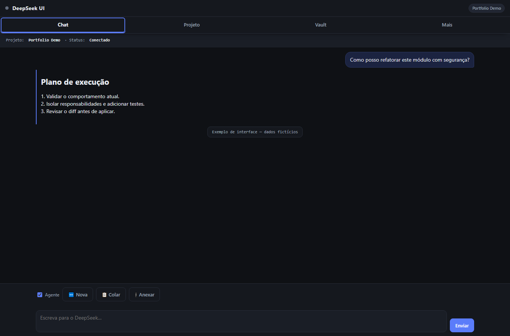
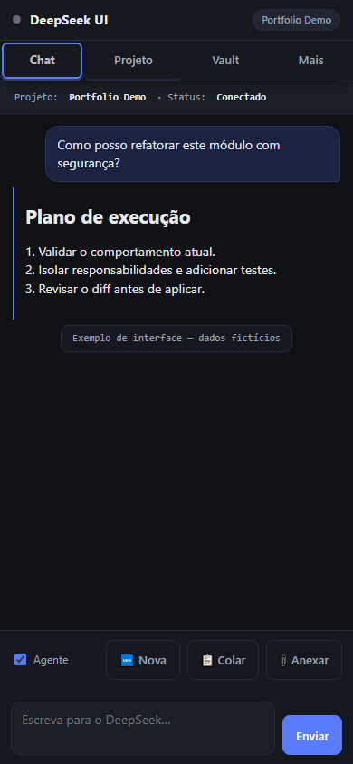

# DeepSeek UI

**Assistente de programação para Windows com interface desktop, integração ao navegador e ferramentas para trabalhar em projetos locais.**

  

O DeepSeek UI conecta uma sessão do [DeepSeek](https://chat.deepseek.com/) no navegador às ferramentas do computador. O objetivo é reunir conversa, arquivos, comandos e revisão de alterações em um único ambiente de trabalho.

## Interface

| Painel remoto no desktop | Painel remoto no celular |
| --- | --- |
|  |  |

*Capturas do painel remoto com conteúdo de demonstração.*

## Funcionalidades

- **Chat por projeto:** organize conversas e mantenha o contexto da pasta de trabalho selecionada.
- **Assistência em código:** explore arquivos, peça modificações e acompanhe as alterações propostas.
- **Revisão de arquivos:** visualize diferenças e controle operações de leitura, criação e edição.
- **Execução de comandos:** utilize ferramentas de terminal integradas ao fluxo de desenvolvimento.
- **Modo agente:** execute tarefas em etapas, com ações e decisões ao longo do processo.
- **Histórico e anexos:** consulte conversas anteriores e envie materiais de apoio.
- **Acesso remoto opcional:** acompanhe chat, projetos e decisões pelo painel web em uma rede privada.

## Como funciona

1. Abra o DeepSeek UI no computador.
2. Conecte o navegador e entre na sua conta do DeepSeek.
3. Selecione a pasta do projeto que deseja trabalhar.
4. Descreva a tarefa no chat.
5. Revise os arquivos, diferenças e comandos antes de autorizar ações.

A conexão com o DeepSeek é realizada pela interface web usando **Selenium**. O aplicativo não utiliza a API oficial do serviço.

## Executar no Windows

**Requisitos:** Windows, Python 3.10 ou superior e Google Chrome.

```powershell
git clone https://github.com/JackNoArms/deepseek_ui.git
cd deepseek_ui
.\executar_main.bat
```

Também é possível iniciar manualmente:

```powershell
python -m venv .venv
.\.venv\Scripts\python.exe -m pip install -r requirements.txt
.\.venv\Scripts\python.exe main.py
```

A integração pelo navegador pode precisar de ajustes quando a interface do DeepSeek mudar.

## Tecnologias

| Tecnologia | Utilização |
| --- | --- |
| **Python** | Lógica da aplicação e ferramentas de desenvolvimento |
| **PyQt6** | Interface desktop |
| **Selenium** | Integração com o navegador |
| **HTML, CSS e JavaScript** | Painel web responsivo |
| **Tailscale Serve (opcional)** | Acesso remoto em rede privada |
| **Pytest** | Testes automatizados |

## Organização do projeto

```text
main.py              Inicialização do aplicativo
src/                 Interface, integrações e ferramentas
testes/              Testes automatizados
docs/                Imagens e documentação da interface
executar_main.bat    Inicialização no Windows
```

## Testes

```powershell
python -m pip install pytest
python -m pytest testes/ -q
```

**Importante:** a execução de comandos e alterações em arquivos pode modificar o computador. Confira as ações propostas e utilize permissões adequadas ao projeto.

*Projeto independente, sem afiliação oficial com o DeepSeek.*
